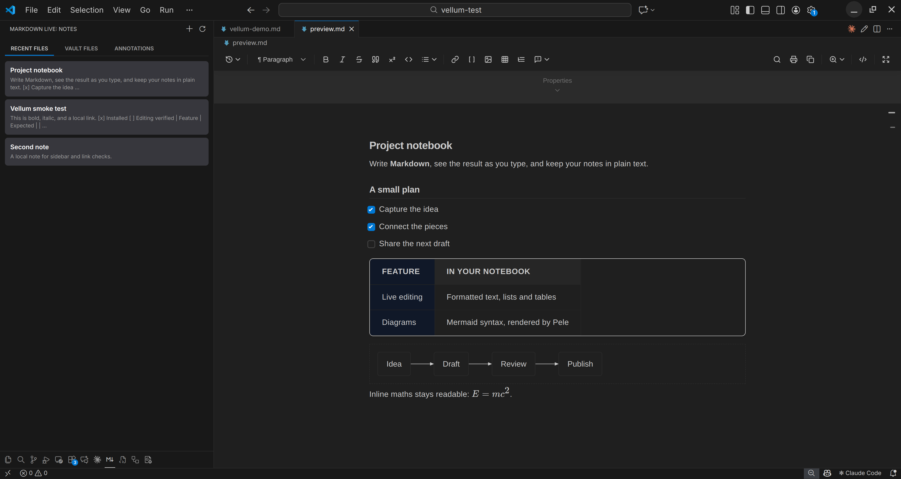
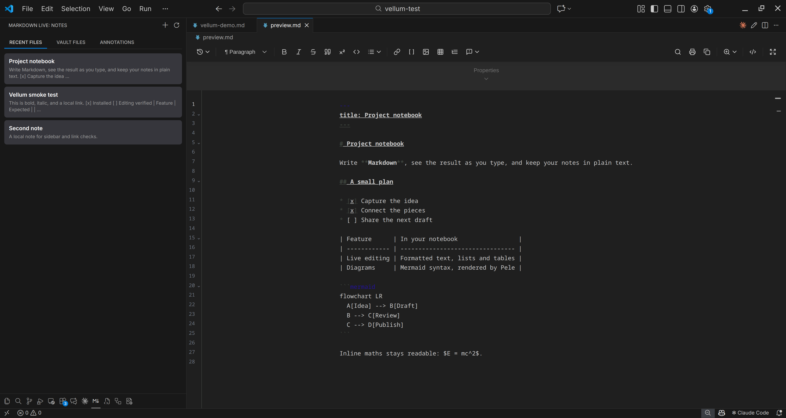

# Vellum Markdown Editor

A live, what-you-see-is-what-you-get Markdown editor for VS Code, with diagrams rendered by
[Pele](https://github.com/obsidianmd/pele) and webviews locked down by a strict content
security policy.

Vellum is a modified version of
[**Obsidian-style Markdown Live Editor**](https://github.com/thinh-vu/vscode-markdown-editor)
by Thinh Vu, released under the same licence, GPL-3.0. See [Attribution](#attribution-and-licence).

## Preview

The live editor and notes sidebar in VS Code, with task lists, a table, a Pele-rendered
flowchart and inline maths:



<details>
<summary>See the same note in source mode</summary>

Switch between rendered Markdown and the built-in CodeMirror source editor using the
**Toggle Source Mode** button in the toolbar.



</details>

These screenshots show the installed extension on Linux. Open the
[example note](assets/previews/demo.md) to try the same content.

## What it does

- **Live editing.** Edit rendered Markdown directly (Milkdown), or switch to a source view
  (CodeMirror 6) that stays in sync.
- **Diagrams.** Fenced `mermaid` blocks render in place and follow your VS Code theme. A syntax
  error shows the line and a caret under the fault.
- **Maths, tables and GitHub-flavoured Markdown.** KaTeX, a table context menu, admonitions,
  task lists and YAML front matter.
- **Slash commands and templates.** Type `/` for a quick-insert menu; keep your own templates in
  a folder.
- **Images.** Paste or drop an image to save it under a configured directory; rename it from
  the context menu.
- **Wikilinks and backlinks.** `[[Note]]` links that resolve by name, a Backlinks panel, and
  links that follow a note when it is renamed. See [Links and backlinks](#links-and-backlinks).
- **Outline.** A fly-out outline tracks headings.
- **Sidebar.** Recent notes, the whole workspace, and bookmarks.
- **PDF export.** Paginated preview with header, footer, page numbers and an optional contents
  page.
- **Works with Claude Code.** Send a selection to Claude as a file reference with its line
  range, keep your place when Claude edits the note, and hand Claude a note's backlinks. See
  [Working with Claude Code](#working-with-claude-code).

## What differs from upstream

| Area | Upstream 0.1.4 | Vellum |
|---|---|---|
| Diagram renderer | Mermaid 10 and 11, both bundled | Pele 1.12.0: no dependencies, synchronous, no `eval` |
| Editor bundle | 7.75 MB | 2.26 MB |
| Sidebar webview | No content security policy; a value from a workspace file reached an inline handler | Nonce policy, no inline handlers, all values escaped |
| PDF export | Loaded a script from a CDN, unpinned | Pinned copy, checked by SHA-256 at build, bundled |
| Editor webview | `'unsafe-eval'`; Google Fonts fetched on every open | Neither |
| Raw HTML and diagram output | Assigned to `innerHTML` | Sanitised, attached as nodes |
| npm advisories | 28, one critical | 19, none critical; one low-severity issue ships |

The full review, including what is **not** fixed, is in [SECURITY-REVIEW.md](SECURITY-REVIEW.md).

### Diagram compatibility

Mermaid stays the source syntax, so your documents do not change. Pele targets Mermaid 12.1
syntax and lays diagrams out with its own engine, so a diagram can look different from
Mermaid's rendering. Mermaid themes, `%%{init}%%` directives and click handlers are not
honoured.

## Links and backlinks

Vellum links notes the way Obsidian does, and stores them as plain `[[wikilinks]]` in the file.

- **Write a link.** Type `[[` to pick a note, or type a name that does not exist yet. Typing a
  closing `]]` by hand works too. `[[Note#Heading]]`, `[[Note|shown text]]` and `![[Note]]` are
  kept exactly as written.
- **Follow a link.** Click it. A link to a note that does not exist is shown dashed, and
  clicking it creates the note, in `markdownLive.defaultNoteDirectory` if set, otherwise beside
  the note you are in.
- **Resolution.** `[[Note]]` finds `Note.md` anywhere in the workspace, ignoring case.
  `[[folder/Note]]` narrows it. When two notes share a name, Vellum writes the shortest path
  that is unambiguous.
- **Backlinks panel.** In the Markdown Live sidebar. For the note in focus it lists *linked
  mentions* (every line in another note that links here, wikilink or Markdown link) and
  *unlinked mentions* (its name appearing as plain text), with a button to turn a mention into
  a link.
- **Rename safely.** Rename or move a note or a folder in the Explorer and every link to it is
  rewritten in the same step, so one undo reverts both. Headings and shown text are kept; links
  that still resolve are left alone. Turn this off with `markdownLive.updateLinksOnRename`.
- **In the plain text editor too.** Wikilinks are clickable and `[[` completes note names.

Limits: `![[Note]]` renders as a link, not an inline copy of the note. Heading links open the
note but do not scroll to the heading. There is no graph view, no hover preview and no block
references. A wikilink is edited by deleting and retyping it, or in source mode. Inside a table
write the pipe as `\|`. Links resolve within one workspace folder.

## Working with Claude Code

Vellum is a custom editor. While it has focus VS Code has no active *text* editor, so an
assistant that reads "the open file and the selection" sees neither. Vellum closes that gap
for the [Claude Code extension](https://marketplace.visualstudio.com/items?itemName=anthropic.claude-code)
(`anthropic.claude-code`); the same commands work with any assistant that accepts text.

| What you want | Command | Shortcut |
|---|---|---|
| Give Claude the selection | **Send Selection to AI Assistant** | `Ctrl + Shift + L` (`Cmd + Shift + L`) |
| See the same lines in a normal text editor | **Reveal Selection in Text Editor** | `Ctrl + Alt + Shift + T` (`Cmd + Ctrl + Shift + T`) |
| Paste a reference yourself | **Copy @-Reference to Selection** | — |
| Give Claude a note and everything linked to it | **Copy Note and Its Links as AI Context** | button on the Backlinks panel |

- **Selections become references.** A selection in the rendered note is mapped back to its lines
  in the Markdown file and written as `@notes/plan.md#18-19`, the form Claude's prompt box
  accepts. With nothing selected the reference is the whole file. The reference is always copied
  to the clipboard as well.
- **How it reaches Claude** is set by `markdownLive.claudeDelivery`:
  - `selection` (default): the note opens in a text editor beside Vellum with those lines
    selected. Claude attaches the open file and selection by itself, and if Claude's "Insert
    @-Mention Reference" command is available Vellum runs it.
  - `newTab`: a new Claude tab opens with the reference pre-filled, not sent.
  - `clipboard`: copy only.
- **Claude's edits appear in place.** When Claude, or anything else, changes the file, the note
  updates and the cursor and scroll position stay where they were. Vellum does not write the
  file back after an outside change, so Claude's formatting is kept and the note is not marked
  as modified. Upstream re-saved the file in its own formatting about 200 ms after every outside
  change, which could make an assistant's next edit fail with "file has changed".
- **Link context.** *Copy Note and Its Links as AI Context* copies the note, the notes that link
  to it (with line numbers), the notes it links to and any links to missing notes, as
  `@`-references. With Claude installed it offers to open them in a new Claude tab.
- **Other assistants.** `markdownLive.aiTarget` chooses `claude`, `antigravity`, `chat` (the
  built-in chat) or `clipboard`; `auto` picks the first that is installed.

Limits: with nothing selected and Vellum focused, Claude does not see which note is open; use
Reveal or Send. While Claude is showing a proposed change to a note as a diff, opening that note
in Vellum shows a notice in place of the editor until the diff is closed. Line mapping is exact
in source view and matched by content in the rendered view, so a selection inside one of two
identical lines can land on the nearer one.

## Status

Not yet published to the VS Code Marketplace; [PUBLISHING.md](PUBLISHING.md) has the steps.

The editor itself (rendering, diagrams, wikilinks, selection mapping, reloading after an outside
edit) is tested in Chromium under the shipped content security policy, and the logic behind
links, renames and references by 51 unit tests. The parts that need VS Code itself (the
Backlinks panel, rename handling and delivery to Claude Code) are tested against a stand-in for
the VS Code API and are listed under "Not yet verified" in the [changelog](CHANGELOG.md) until
they have been confirmed in VS Code. Please report anything that misbehaves.

## Build and install

Requires Node 20 or later.

```sh
npm ci --ignore-scripts      # install scripts are not needed to build
npm run test:unit            # 51 tests
npm run package              # verifies the pinned assets, then bundles into dist/
npx @vscode/vsce package     # produces a .vsix
code --install-extension vellum-markdown-editor-*.vsix
```

`npm run package` fails if Pele or Paged.js does not match its pinned SHA-256
(`scripts/verify-pins.mjs`).

After replacing an installed build, run **Developer: Reload Window** from the Command
Palette. To reinstall the same version, add `--force` to `code --install-extension`.

Vellum keeps upstream's command and setting identifiers (`markdown-live.*`, `markdownLive.*`),
so existing settings and keybindings carry over. For the same reason, **do not install it
alongside the upstream extension**: the two would register the same commands and editor.

## Use

Open a `.md` file, then any of:

1. `Ctrl + Alt + Shift + M` (`Cmd + Ctrl + Shift + M` on macOS).
2. Right-click the file in the Explorer and choose **Open in Markdown Live Editor**.
3. Click the pencil icon at the top right of the text editor.

For a quick smoke check, use a disposable folder with two Markdown notes. Include YAML
front matter, formatted text, a task list, a table, inline maths and a fenced `mermaid`
flowchart. Confirm that content loads on opening; edit and save, then inspect the file on
disk. Toggle source mode, open **Markdown Live: Focus on Notes View**, and paste an image
to check that it is written under `assets/images` and displayed. Click **Export PDF** to
generate `.vscode/print-preview.html`, open it in your browser and use **Ctrl+P** (macOS:
**Cmd+P**) to print or save as PDF. The preview file remains on disk.

| Command | macOS | Windows and Linux |
|---|---|---|
| Open live editor | `Cmd + Ctrl + Shift + M` | `Ctrl + Alt + Shift + M` |
| Send selection to AI assistant | `Cmd + Shift + L` | `Ctrl + Shift + L` |
| Reveal selection in text editor | `Cmd + Ctrl + Shift + T` | `Ctrl + Alt + Shift + T` |
| Insert link | `Cmd + K` | `Ctrl + K` |
| Insert table | `Cmd + Option + T` | `Ctrl + Shift + T` |
| Insert code block | `Cmd + Option + C` | `Ctrl + Shift + C` |
| Bold | `Cmd + Option + B` | `Ctrl + Shift + B` |
| Italic | `Cmd + I` | `Ctrl + I` |
| Heading 1 to 6 | `Cmd + Option + 1-6` | `Ctrl + Shift + 1-6` |

## Settings

| Setting | Default | Purpose |
|---|---|---|
| `markdownLive.language` | `en` | Interface language (`en` or `vi`) |
| `markdownLive.fontFamily` | `sans-serif` | `sans-serif` or `serif`; local fonts only |
| `markdownLive.tableDisplayMode` | `scroll` | `scroll` or `wrap` for wide tables |
| `markdownLive.enableSlashCommand` | `true` | The `/` menu |
| `markdownLive.defaultNoteDirectory` | empty | Where new notes are created |
| `markdownLive.sidebarScanDirectory` | empty | Folder the sidebar lists |
| `markdownLive.templateFolder` | empty | Folder of note templates |
| `markdownLive.imageDirectory` | `assets/images` | Where pasted images are saved |
| `markdownLive.imagePublicPath` | empty | Prefix for image paths that start with `/` |
| `markdownLive.printHeaderFormat` | `{title}` | PDF header; accepts front-matter variables |
| `markdownLive.printFooterFormat` | `{signature}` | PDF footer |
| `markdownLive.printPageNumberFormat` | `{page}` | PDF page numbering |
| `markdownLive.printFontFamily` | empty | Font for PDF export |
| `markdownLive.printAutoTOC` | `false` | Insert a contents page when exporting |
| `markdownLive.updateLinksOnRename` | `true` | Rewrite links when a note or folder is renamed or moved |
| `markdownLive.aiTarget` | `auto` | Assistant for Send Selection: `auto`, `claude`, `antigravity`, `chat`, `clipboard` |
| `markdownLive.claudeDelivery` | `selection` | How a selection reaches Claude Code: `selection`, `newTab`, `clipboard` |

## Privacy

Vellum sends no telemetry and makes no network request of its own. A note that references an
image on a remote server will still load that image when opened, as Markdown images do.

## Attribution and licence

Vellum Markdown Editor is free software under the **GNU General Public License, version 3**
([LICENSE](LICENSE)). It comes with no warranty.

- It is a modified version of **Obsidian-style Markdown Live Editor** 0.1.4, © 2026 Thinh Vu
  ([thinh-vu/vscode-markdown-editor](https://github.com/thinh-vu/vscode-markdown-editor),
  commit `b90af69`), licensed GPL-3.0. Upstream's own README is kept as
  [README.upstream.md](README.upstream.md).
- Modifications © 2026 DreamLab AI Consulting Ltd, first made on 14 November 2026 and listed in
  [CHANGELOG.md](CHANGELOG.md) and [SECURITY-REVIEW.md](SECURITY-REVIEW.md).
- Third-party components and their licences are listed in [NOTICE.md](NOTICE.md).

Vellum is not affiliated with or endorsed by Thinh Vu, Vnstock, Obsidian or Dynalist Inc.
"Obsidian" and "Mermaid" are names of their respective owners, used here only to describe
compatibility. Security fixes are offered back to upstream; please report problems with this
version in this repository, not upstream.
