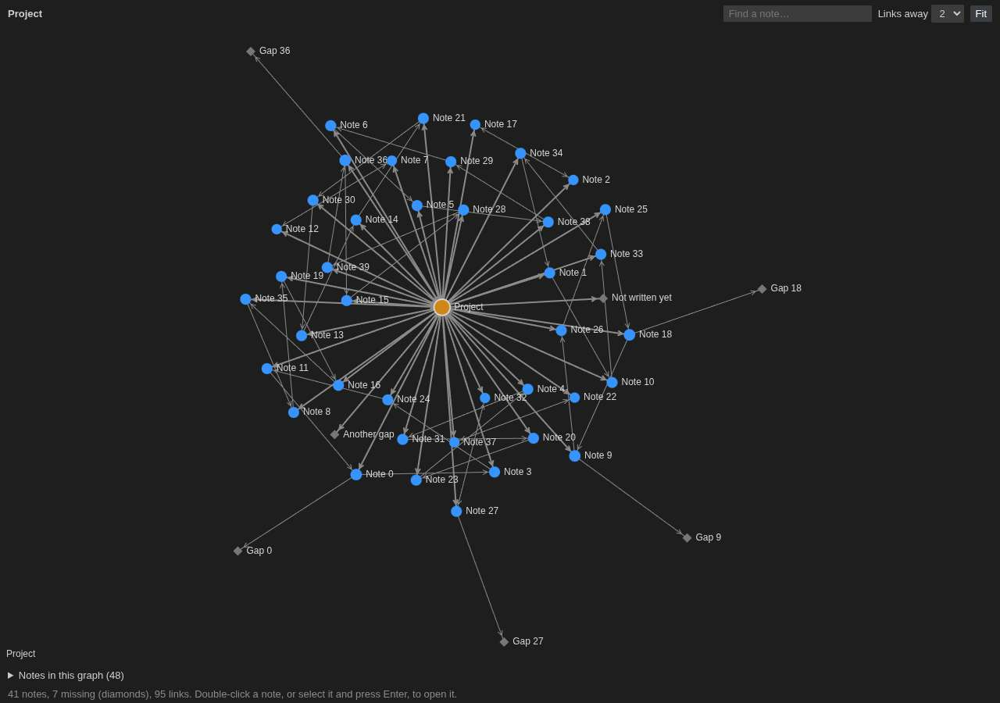

# Desktop feature check — 2026-11-14

## Environment and isolation

- Source: Vellum 0.4.0, built from this checkout.
- Host: desktop VS Code 1.106.3 (`bf9252a`), Linux x64.
- Node: 26.10.0; Chromium: 153 for the standalone print check.
- Interaction: Playwright and Chromium DevTools Protocol against the actual desktop
  VS Code window and its extension webviews, with filesystem and clipboard assertions.
- Workspace: disposable `/tmp/vellum-feature-check`, seeded from the same content as
  [demo](demo). No tests edited the user's notes.
- Profile: `/tmp/vellum-vscode-profile`; extensions: `/tmp/vellum-vscode-extensions`.
  The latter contained no installed extensions. VS Code's renderer log confirmed
  `/home/john/githubs/vellum-markdown-editor` as the development extension path;
  its web-worker extension log recorded one Vellum activation.
- The normal profile had Vellum 0.2.0 installed. It was excluded from the test window,
  as were Claude Code and other third-party extensions. The normal installation was
  not upgraded or removed.

The [walkthrough](WALKTHROUGH.md) contains the screenshots and repeatable user steps.
Screenshots 01–07 are VS Code captures; screenshot 08 is the exported HTML rendered
in headless Chromium. They show successive states of the disposable notebook.

## Results

| Flow | Evidence | Result |
|---|---|---|
| Activation without duplicate registration | Development extension path and one activation in VS Code logs | Pass |
| Live rendering | Heading, bold text, three tasks, table, Pele flowchart, KaTeX expression visible | Pass |
| Source edit → live view → save | Added sentence appeared in both rendered content and disk file | Pass |
| Live edit → save | Added sentence persisted in Markdown on disk | Pass |
| Follow missing wikilink | Clicking `Next steps` created and opened `Next steps.md` | Pass |
| Backlinks | Two linked mentions and one unlinked mention for `Project.md` | Pass |
| Link This Mention | Count changed to three linked/zero unlinked; `[[Project]]` persisted in `Review.md` | Pass |
| Explorer file rename | `Project.md` → `Roadmap.md`; two wikilinks and one Markdown link rewritten, then saved | Pass |
| New Note from Template | Chose `Meeting.md`; `Weekly review.md` contained Agenda, Actions, and a task | Pass |
| Slash menu | `/` in an empty paragraph showed the block choices | Pass (menu only) |
| Image save and insert | Injected `ClipboardEvent` with a PNG File; file saved under `assets/images`, relative link persisted, rendered image loaded at 128 px | Pass (webview pipeline) |
| Copy selection reference | Selected opening rendered paragraph; clipboard read back `@Roadmap.md#7` | Pass |
| Reveal selection | Actual text editor opened beside Vellum with line 7 selected | Pass |
| Copy link context | Clipboard contained note, incoming `@Review.md#3/#5/#7`, and two outgoing note references | Pass |
| Outside file change | New text appeared, selection remained, zero dirty tabs, SHA-256 unchanged after reload | Pass |
| Print export | Toolbar generated `.vscode/print-preview.html`; Paged.js produced one page, zero page errors; PDF metadata confirmed A4 | Pass with contrast issue |
| Original branding | New folded-vellum V icon replaces upstream PNG; checked at 256 px and 32 px | Pass |

## Limitations and follow-up

- **PDF contrast:** the dark theme's pale text remains pale on the white printed page;
  the diagram retains dark boxes. The captured preview records the issue. Pagination
  and PDF generation pass; visual print quality needs work.
- **System image clipboard:** an attempted Wayland clipboard image transfer pasted
  the previous text payload into this X11/Electron session. The image handler was
  then verified with an injected image clipboard event. Native image paste and drag
  and drop are not claimed as verified here.
- **Find:** a search for `Roadmap` while inspecting source mode returned “No results”.
  Live-mode find/replace was not established by this run; do not infer coverage from
  the toolbar's presence.
- **Not exercised:** actual Claude Code, Antigravity or built-in chat delivery;
  folder moves, rename undo, duplicate-note resolution in the UI; native text-editor
  wikilink completion; table mutation/context menu; slash-menu insertion; image rename;
  annotations; outline navigation; settings variants; multi-page PDF/TOC; Windows/macOS.
- After reopening the Notes webview it sometimes remained on “Loading notes…”.
  Clicking the view’s **Refresh Notes** button populated it.
- The new-notes sidebar lists template files as notes when it scans the whole workspace.
  Set `markdownLive.sidebarScanDirectory` to a notes folder if that is undesirable.

## Build and automated checks

All **51 unit tests passed**, including diagram rendering, link parsing/resolution,
rename edit planning, selection reference mapping, and security helpers.
Both pinned vendor hashes passed: Pele 1.12.0 and Paged.js 0.4.3. Extension and webview
bundles built successfully. Final VSIX packaging also passed (13 files, 1.93 MB),
with the new 256 px icon included and documentation masters excluded. Packaging used
`pnpm --package npm --package @vscode/vsce dlx -c 'vsce package --no-dependencies --out /tmp/vellum-markdown-editor-0.4.0.vsix'`,
which supplies npm temporarily for the prepublish build. Since `npm` was absent from
the original shell, the initial build and unit-test run used the
commands behind the package scripts directly:

```sh
node_modules/.bin/esbuild test/unit/*.test.ts --bundle --platform=node --format=esm \
  --alias:vscode=./test/stubs/vscode.ts --outdir=.test-out --out-extension:.js=.mjs
node --test .test-out/*.mjs
node scripts/verify-pins.mjs --copy
node_modules/.bin/esbuild ./webview/main.ts --bundle --outfile=dist/webview.js \
  --platform=browser --minify --loader:.woff2=dataurl --loader:.woff=dataurl --loader:.ttf=dataurl
node_modules/.bin/esbuild ./src/extension.ts --bundle --outfile=dist/extension.js \
  --external:vscode --format=cjs --platform=browser
```

The placeholder `src/test/extension.test.ts` suite was not used as evidence for these
flows. Stand-in API unit tests and the actual desktop checks are distinct coverage.

## Headless CLI review — 2026-11-14

The subsequent `vellum-graph` update passes all 63 tests (the original 51, seven
Vault tests, and five CLI integration tests that execute the bundled CLI). Checked
backlinks, mentions, unresolved targets, and graph output against `docs/demo`.
The demo's unresolved `Next steps` link is intentional.

Review reproduced a folder rename into its own descendant that rewrote links before
the filesystem rejected the move. The CLI now rejects that move before editing,
normalises backslash paths consistently for planning and execution, and refuses to
overwrite dangling symlinks. Regression tests verify saved files after successful
moves and unchanged links after rejected moves, plus JSON and exit-code behaviour.
Renames remain non-atomic for unexpected I/O failures, as documented in the README.

VSIX packaging also passed after the CLI addition: the extension remains a browser
bundle; CLI output, source, tests, and the agent briefings stay out of the package.

## Note graph — 2026-11-14

`npm run test:unit` passes 79 tests: the 63 above, eleven in `test/unit/graph.test.ts` and one
more CLI test. `npm run package` and `vsce package` succeed; the VSIX grows from 2.02 MB to
2.17 MB and gains `dist/graph.js` (387 KB, of which the layout module is 269 KB before
base64) and four files under `dist/licenses/`.

Covered by unit tests, with a stand-in for the VS Code API:

- The pure neighbourhood: both link directions, depth 1 to 3, missing notes, front matter and
  code excluded, clashing names, the node bound and its hidden count, clamped bounds.
- The extension index and the CLI vault return the same graph for the same notes.
- Message validation: only `ready`, `open` and `bounds` pass, with exact shapes.
- The panel: opens beside without taking focus; the exact policy string; opens only a note in
  the graph on screen, in the followed note's column; ignores missing notes, notes not on
  screen, paths, URIs, stale generations and unknown message types; follows the note in focus;
  keeps its graph when its own tab has focus; says why there is no graph; reuses one panel;
  stops posting once closed; does nothing while hidden and catches up when shown.
- The hidden count covers every level in range; spellings that resolve alike name one
  missing note.

Run in a browser. The panel's real HTML, policy and bundled script were served to Chrome
(the browser sidecar) with two additions: a nonce'd stand-in for `acquireVsCodeApi` that
recorded messages and replied to `ready` with a graph the panel had produced, and a style
sheet defining the VS Code theme variables a dark theme would supply. The graph was a note
with 40 linked notes and seven missing ones, two links away: 48 nodes and 95 links.

| Check | Result |
|---|---|
| WebAssembly module compiles under `script-src 'nonce-…' 'wasm-unsafe-eval'` | Pass |
| Layout arranges the graph and settles; the view fits itself until then | Pass |
| Console errors or policy violations | None |
| Resources loaded | The page's own script only |
| Enter on the selected note, and a button in the notes list, send `open` with the node ID and generation | Pass |
| Search selects a match; Enter on a missing note explains and sends nothing | Pass |
| The *Links away* control sends `bounds` | Pass |
| Dragging a note moves it; no error | Pass |



Not established by this run:

- **Installed VS Code and vscode.dev.** The panel has not been opened in either. That leaves
  unverified: the command and its three menu entries, the panel opening beside the editor,
  following the note in focus across real tab groups, opening a note in the right column,
  theme variables and theme switching as VS Code supplies them, the `…` menu's `when` clause
  for the custom editor, and behaviour on remote or virtual workspace URIs.
- **Multi-root workspaces.** The index scopes a graph to one folder and the tests use one.
- **Edits while the graph is open.** The index path is tested; the on-screen effect of typing
  a link (new note arriving beside its neighbours, positions kept) was not watched.
- **Large vaults in the extension host.** The graph is rebuilt, synchronously, each time the
  link index changes while the panel is visible. An independent review measured the first
  version of that rebuild on a synthetic vault (ten wikilinks a note, 50 folders) at 1.75 s
  for 1,000 notes and 63 s for 6,000, because every link was resolved by scanning every
  note. It now resolves through an index built once per rebuild (`createResolver`, checked
  against `resolveLink` link by link in the tests): 41 ms, 67 ms and 128 ms for 1,000, 3,000
  and 6,000 notes on the same script, one run each on this machine under Node. A hidden
  panel does not rebuild. The Backlinks panel's own queries still scan per link and were
  not changed; the review measured them at about 15 s for 3,000 notes on that vault.
- **Large graphs.** Nothing near the 1,000-note limit was drawn, and no timing was taken. In
  Node, 300 layout steps for 500 nodes and 896 links took about 0.4 s in total; in the panel
  that work is spread over frames of at most 6 ms. That is one informal run, not a benchmark.
- **Screen readers.** The canvas has a label and the notes list is real buttons; neither was
  tried with assistive technology.
- **A module that fails to start.** The fallback path is in the code and in the shared
  driver's tests; it was not forced in the browser.

