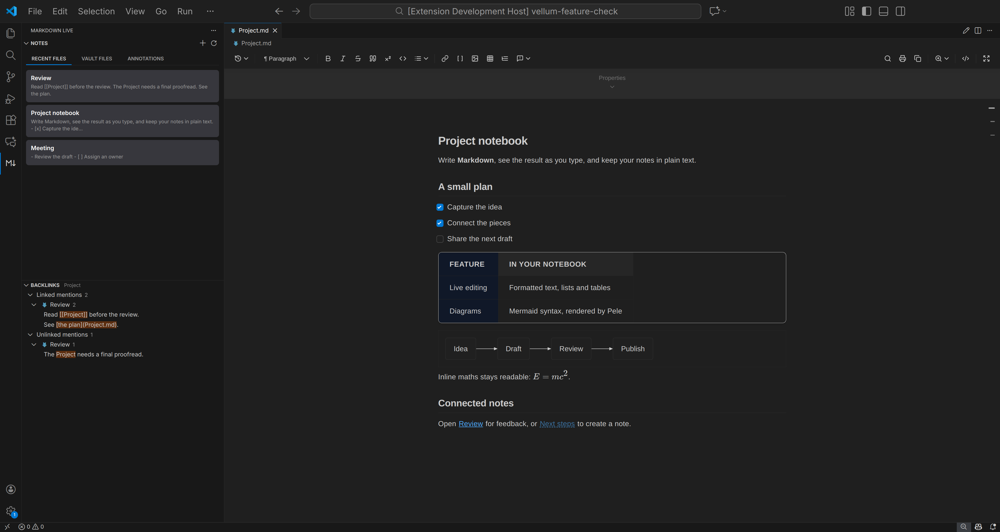
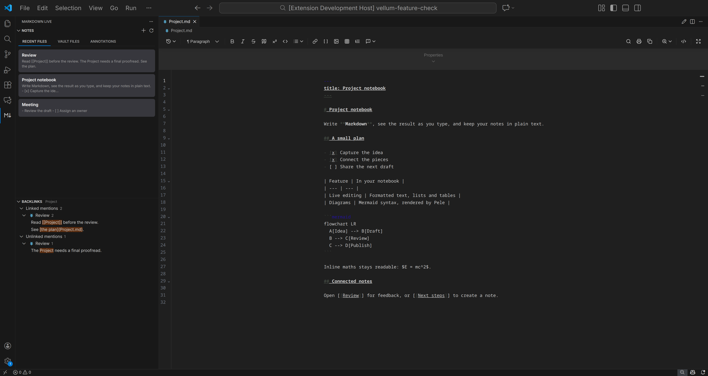
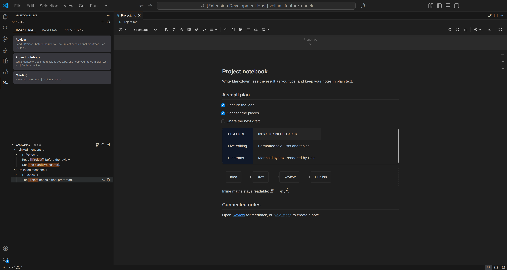
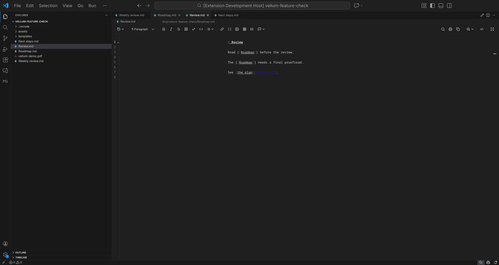
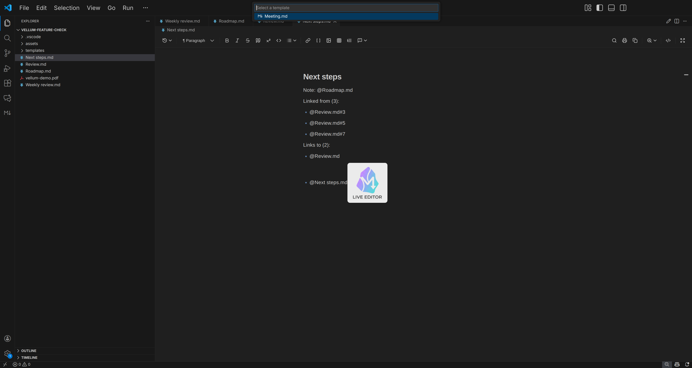
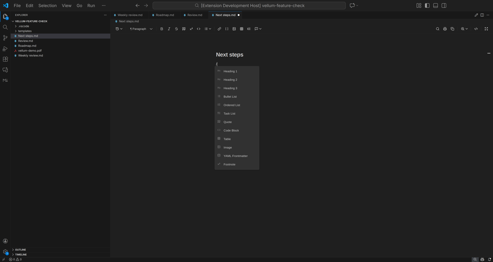
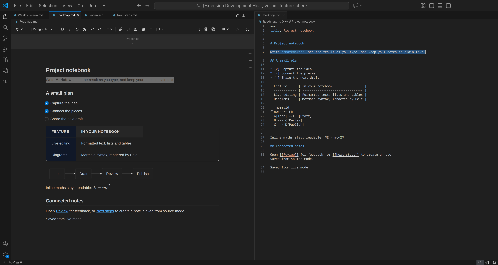
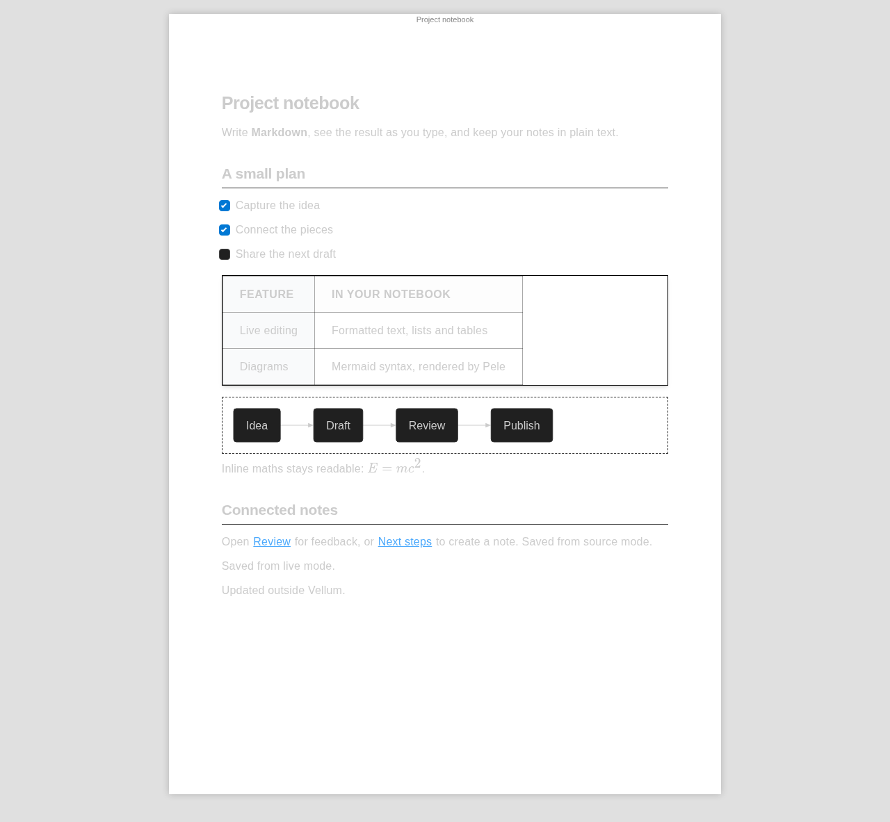

# Vellum in VS Code

These flows were exercised with Vellum 0.4.0 in desktop VS Code 1.106.3 on Linux.
Screenshots show the actual extension running in an Extension Development Host;
the print screenshot shows the generated HTML in Chromium. See the
[test report](TESTING.md) for coverage and limitations.

## Start with a disposable notebook

Copy [demo](demo) somewhere outside this repository and open that copy as a VS Code
folder. Opening it as its own workspace makes note resolution and template paths
match this guide. For example, from the repository root:

```sh
cp -R docs/demo /tmp/vellum-notebook
code --new-window /tmp/vellum-notebook
```

The copy includes `Project.md`, `Review.md`, and `templates/Meeting.md`. Its workspace
settings enable the template folder and choose clipboard delivery for AI commands.
Use a fresh destination when repeating the walkthrough: the steps create and rename files.

Vellum and the upstream Obsidian-style Markdown Live Editor share command and editor
identifiers. Disable the upstream extension in this workspace before testing Vellum.
When replacing an older Vellum VSIX, install with `--force` and run **Developer: Reload
Window**. In Extensions, check that **Vellum Markdown Editor**, publisher `dreamlab-ai`,
has the version you intend to test.

## 1. Open, edit, and save

1. Open `Project.md`. If it opens as plain text, run **Open in Markdown Live Editor**
   from the Command Palette, or use the file's Explorer context menu.
2. Open the Markdown Live activity-bar view, or run **Markdown Live: Focus on Notes View**.
3. If Notes stays on “Loading notes…” after reopening the sidebar, click its
   **Refresh Notes** button. Check the rendered heading, bold text, task list, table,
   flowchart, and inline maths.
4. Edit a paragraph directly in the rendered note, allow the edit to reach VS Code,
   and save with **Ctrl+S** (**Cmd+S** on macOS). Check the Markdown on disk.



The note remains a plain Markdown file. Live editing may normalise Markdown layout,
including list markers and table spacing.

## 2. Switch between source and rendered text

Click **Toggle Source Mode** (`</>`) in Vellum's toolbar. This opens its built-in
CodeMirror editor, inside the same custom editor. Append a sentence, save, and toggle
back: the rendered note should contain that sentence. The Mermaid source stays in a
fenced `mermaid` block.



**Open in VS Code Text Editor** is a separate toolbar action. It switches to VS Code's
normal text editor; use it when another extension needs an active text editor.

## 3. Follow and create linked notes

In the rendered `Project.md`, click **Review** in “Connected notes”: it opens the
existing note. Return to `Project.md` and click the dashed **Next steps** link.
Vellum creates `Next steps.md` beside the source note and opens it. A configured
`markdownLive.defaultNoteDirectory` changes where missing notes are created.

To insert a link, type `[[` in the live editor or use **Insert Wikilink** in the toolbar.
Choose an existing note, or enter a new name. Choosing a new name inserts a link;
the file is created when you follow that link.

## 4. Turn a mention into a backlink

Return to `Project.md` and expand **Backlinks**. Before changing the demo, expect:

- **Linked mentions: 2** — the wikilink and Markdown link in `Review.md`.
- **Unlinked mentions: 1** — “The Project needs a final proofread.”

Hover that unlinked line and click **Link This Mention**. It becomes
`The [[Project]] needs a final proofread.` in `Review.md`; the panel then shows three
linked mentions and zero unlinked mentions. Use **File: Save All Files** to persist
any open documents, and inspect `Review.md` on disk.



Click a mention to open its note. **Open at Line in Text Editor** reveals the exact
source line in the normal VS Code editor.

## 5. Rename without breaking links

1. In the Explorer, select `Project.md`, press **F2**, and rename it to `Roadmap.md`.
2. Let VS Code finish the rename, then run **File: Save All Files**.
3. Open `Review.md` in source mode. Both `[[Project]]` links now read `[[Roadmap]]`;
   `[the plan](Project.md)` now reads `[the plan](Roadmap.md)`.
4. Follow a rewritten link to confirm it opens the renamed note.



This depends on `markdownLive.updateLinksOnRename` (enabled by default). Use the
VS Code Explorer for this flow: a rename outside VS Code does not emit its
`onWillRenameFiles` event.

## 6. Create a note from a template

The demo configures `markdownLive.templateFolder` as `templates`.

1. Run **New Note from Template**.
2. Select `Meeting.md`.
3. Enter `Weekly review` as the new note's name.
4. Confirm `Weekly review.md` opens with Agenda, Actions, and a task list.



**New Note** also offers an empty note or a template when a template folder is set.
**Markdown Live: Insert Template** inserts a template into the current note instead.
New-note templates replace `{{title}}`; insertion templates support
`<% tp.file.title %>` and `<% tp.date.now("YYYY-MM-DD") %>`.

## 7. Insert blocks with the slash menu

Open `Next steps.md`, place the cursor on an empty paragraph, and type `/`.
Choose a heading, list, quote, code block, table, image, front matter, or footnote.
Press **Escape** to dismiss the menu.



For images, paste an image into the live editor. Vellum writes the file under
`assets/images` by default and inserts a relative Markdown image path. The test run
verified this pipeline using an injected image clipboard event; operating-system
image clipboard transfer still needs a separate check on your platform.

## 8. Give an assistant the right file and lines

Select the opening paragraph in `Roadmap.md` and run
**Markdown Live: Copy @-Reference to Selection**. In this demo the clipboard contains
`@Roadmap.md#7`. **Markdown Live: Reveal Selection in Text Editor** opens the same file
beside Vellum with source line 7 selected.



With the demo's `markdownLive.aiTarget: "clipboard"`, **Send Selection to AI Assistant**
copies a reference and the selected text. Paste that into your assistant yourself.

**Markdown Live: Copy Note and Its Links as AI Context** also copies incoming and
outgoing references. After linking the mention and renaming the demo, its incoming
list includes `@Review.md#3`, `@Review.md#5`, and `@Review.md#7`.

Claude Code delivery is described in the [README](../README.md#working-with-claude-code).
It was not exercised in this isolated test profile. These steps do not send a prompt.

## 9. Export a print preview

Click **Export PDF** in Vellum's toolbar. It writes `.vscode/print-preview.html` in
the workspace and opens it in a browser. Use **Ctrl+P** (**Cmd+P** on macOS) to print or
save as PDF. Header, footer, page-number, font, and contents-page settings are listed
in the [README](../README.md#settings).



The tested preview produced a one-page A4 PDF without JavaScript errors. Dark editor
colours carry into the preview: body text is too pale on white, and diagram boxes
retain dark fills. Check the preview's contrast before distributing an export.

## 10. Keep outside edits

Save `Roadmap.md`, then change the file from another editor or process. The rendered
note should update without becoming dirty or writing the file back. In the test run,
the selected paragraph stayed selected, the new sentence appeared, and the file's
SHA-256 stayed unchanged after reload.
