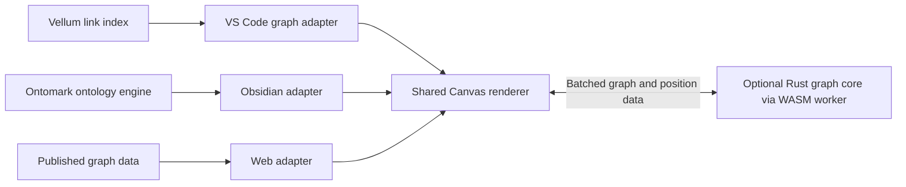

# ADR-VEL-001: share Ontomark graph components while keeping Vellum an editor

## Decision and status

Keep Vellum focused on Markdown editing and note navigation. Add an optional,
on-demand neighbourhood graph using Ontomark's shared renderer. Reuse the same
component in Obsidian and web consumers. Develop portable Rust/WASM graph
computation where measurements justify it, behind the renderer's existing API.

This records the direction agreed in the 14 November 2026 discussion. It does
not claim an implemented graph view, a faster Rust renderer, or accepted changes
in another repository. The [implementation handoff](../handoffs/ontomark-graph.md)
defines the work and release gates. Cross-repository changes land with their
own tests and reviews; this document is the canonical integration decision.

## Context and evidence

Vellum already indexes ordinary Markdown links and wikilinks, resolves targets,
updates links on rename and exposes the graph through a CLI. Ontomark adds a
different layer: typed frontmatter, asserted and inferred relationships, local
reasoning, queries and reviewed edits. A prose link is navigation; it is not an
ontology assertion.

The reviewed source revisions are:

| Repository | Revision | Relevant evidence |
|---|---|---|
| Vellum | `9289375d542430fffb923eb14baac585e2f93d40` | [LinkIndex](../../src/links/linkIndex.ts), [pure parser](../../src/links/parser.ts), [editor save path](../../src/editorProvider.ts) |
| Ontomark | `cf0695c557e109a11a6f4626e76fcebbaa8bb694` | [Renderer API](https://github.com/DreamLab-AI/ontomark/blob/cf0695c557e109a11a6f4626e76fcebbaa8bb694/packages/graph/src/index.d.ts), [implementation](https://github.com/DreamLab-AI/ontomark/blob/cf0695c557e109a11a6f4626e76fcebbaa8bb694/packages/graph/src/index.js), [ADR-OM-002](https://github.com/DreamLab-AI/ontomark/blob/cf0695c557e109a11a6f4626e76fcebbaa8bb694/docs/adr/ADR-OM-002-shared-graph-and-obsidian-boundary.md) |
| Ontomark Obsidian | `db8e6b590fdf6a2e364c8661ec090918b57285c0` | [Host-independent API](https://github.com/DreamLab-AI/ontomark-obsidian/blob/db8e6b590fdf6a2e364c8661ec090918b57285c0/src/api.ts), [graph adapter](https://github.com/DreamLab-AI/ontomark-obsidian/blob/db8e6b590fdf6a2e364c8661ec090918b57285c0/src/views/graph-view.ts), [engine pin](https://github.com/DreamLab-AI/ontomark-obsidian/blob/db8e6b590fdf6a2e364c8661ec090918b57285c0/engine.json) |

`@dreamlab-ai/ontomark-graph` 0.2.0 is a JavaScript Canvas renderer with TypeScript
declarations, not a Rust crate. It owns selection, pan, zoom, dragging, traversal
and cleanup, without vault access or network requests. It accepts node/edge data,
activation callbacks and `Float32Array` position updates. Ontomark's parsing,
reasoning and query engine already compiles from Rust to WASM.

The renderer's 12 existing Node tests passed during this review. No Vellum graph
integration, Rust-versus-JavaScript benchmark or cross-host performance claim
has been verified. Sorting nodes on each redraw and linear pointer hit-testing
are candidate costs visible in the source, not measured bottlenecks.

## Ownership and boundaries

| Layer | Owner | Contract |
|---|---|---|
| Markdown editing, workspace files and navigation | Vellum | Existing pure parser/resolver and LinkIndex remain authoritative for note links; Milkdown and CodeMirror remain the editors. |
| Canvas presentation and interaction | Ontomark `packages/graph` | One shared package, with host-supplied labels, themes, graph data and callbacks. No copied renderer in Vellum. |
| Portable graph computation | Ontomark workspace | A Rust library with a small WASM binding, if the benchmark gate passes. It must build natively and for WASM without depending on either editor. |
| Ontology meaning and inference | Existing Ontomark engine | Typed references, identities, assertions and inferred edges retain the engine's semantics. |
| VS Code or Obsidian integration | Each host | File access, activation, commands, views, exclusions, messages and edit approval. |

The first Vellum view shows the current note and a bounded neighbourhood. It is
opened by an explicit command; it does not add background classification or a
new mandatory setup step. Clicking a node opens its note. Search, focus, keyboard
navigation, theme support and predictable disposal are part of the feature.

Navigation edges and ontology edges remain distinguishable in data and UI.
Missing notes are not represented as inferred facts. Node identity is separate
from the displayed label; a host maps opaque IDs to workspace URIs or entity
IRIs. A webview message never grants arbitrary file or command access.

Vellum remains a web extension: no native executable, localhost service or Node
API is required. VS Code supports JavaScript and WASM in its browser host, with
file access through `vscode.workspace.fs`. A graph is rendered in a webview and
communicates with the host through validated messages. See Microsoft's
[web-extension](https://code.visualstudio.com/api/extension-guides/web-extensions)
and [webview](https://code.visualstudio.com/api/extension-guides/webview) contracts.

## Rust/WASM adoption

Prefer Rust for reusable computation such as layout, spatial indexing,
neighbourhood traversal and filtering when profiling identifies a useful unit
of work. Keep state on one side of the WASM boundary and transfer batches or
typed arrays. Tag asynchronous work with a graph generation; discard results
from superseded snapshots. Worker execution protects editor responsiveness;
WASM alone does not make synchronous work non-blocking.

Compare the current implementation, a reasonably optimised JavaScript baseline
and Rust/WASM with identical inputs and outputs. Measure startup, payload size,
memory and end-to-end interaction as well as computation. A faster kernel that
makes interaction slower does not pass. Keep Canvas painting initially: moving
individual Canvas calls to Rust is not itself a performance argument. A GPU
renderer, native UI or replacement editor would need a separate decision.

Rust code belongs in the shared Ontomark workspace, not inside Vellum. Reuse the
existing graph codec where needed; do not invent another binary format. A useful
new crate ships rustdoc, compiling examples, licences, repository metadata and
native/WASM tests before publication. Package and WASM releases are immutable,
pinned and integrity-checked by consumers. Preserve existing notices and keep
shared code free of imports from Vellum's GPL application layer.

## Compatibility before ontology editing

Vellum currently masks frontmatter and fenced code before parsing links. Its
rename planner therefore does not update a frontmatter reference such as
`subclass-of: ["[[Animal]]"]` when `Animal.md` is renamed. References inside
`ontomark-sparql` fences also require separate treatment. Do not fix this by
treating arbitrary YAML strings or code examples as ordinary links.

Before advertising Ontomark-compatible editing, establish a shared fixture
contract for recognised references, exact preservation of unrelated metadata,
ambiguous names, renames and concurrent edits. Preserve the distinction between
explicit IRIs and path-derived identity. Reuse Ontomark's parser and guarded
patch rules where practical; keep Vellum's CLI and extension in agreement.

A read-only navigation graph can ship independently, with its scope stated.
An ontology mode cannot claim compatibility merely because it draws the notes.

## Alternatives and consequences

- **Copy the Obsidian plugin into Vellum:** rejected. It duplicates host-specific
  UI and introduces reasoning, query and model settings into a general editor.
- **Rewrite the whole editor in Rust:** rejected for this work. It replaces
  established editing behaviour without evidence of a relevant bottleneck.
- **Fork the graph renderer:** rejected. Fixes and interaction behaviour would
  diverge between the existing consumers.
- **Keep all computation in JavaScript:** a valid measured outcome. The shared
  graph view can ship even if WASM does not meet its adoption gate.

The cost is an additional consumer contract, release pin and host acceptance
suite. The benefit is one renderer and reusable computation across projects,
while Vellum's default workflow remains Markdown editing. SPARQL, reasoning,
assisted ingest and model endpoints remain outside this first release; a later
optional Ontomark companion can consume the same components.
