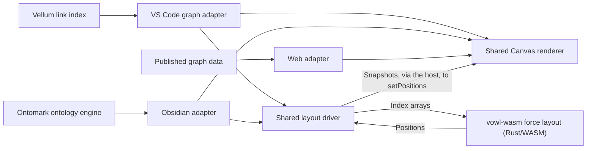

# ADR-VEL-001: share Ontomark graph components while keeping Vellum an editor

## Decision and status

Keep Vellum focused on Markdown editing and note navigation. Add an optional,
on-demand neighbourhood graph using Ontomark's shared renderer. Reuse the same
component in Obsidian and web consumers. Arrange the graph with the estate's
existing Rust/WASM force layout, `vowl-wasm`, through a host-side driver that
sits beside the renderer and that every host can use.

This records the direction agreed in the 14 November 2026 discussion, as amended
the same day once the code was read against it (see [Amendment](#amendment-14-november-2026)).
The bounded graph is built in this repository; the [implementation handoff](../handoffs/ontomark-graph.md)
says what is done and what remains. It does not claim acceptance in an installed
VS Code, any performance result, or typed-vault compatibility.

## Context and evidence

Vellum already indexes ordinary Markdown links and wikilinks, resolves targets,
updates links on rename and exposes the graph through a CLI. Ontomark adds a
different layer: typed frontmatter, asserted and inferred relationships, local
reasoning, queries and reviewed edits. A prose link is navigation; it is not an
ontology assertion.

The reviewed source revisions are:

| Repository | Revision | Relevant evidence |
|---|---|---|
| Vellum | `9289375d542430fffb923eb14baac585e2f93d40` | [LinkIndex](../../src/links/linkIndex.ts), [pure parser](../../src/links/parser.ts), [editor save path](../../src/editorProvider.ts) |
| Ontomark | `cf0695c557e109a11a6f4626e76fcebbaa8bb694` | [Renderer API](https://github.com/DreamLab-AI/ontomark/blob/cf0695c557e109a11a6f4626e76fcebbaa8bb694/packages/graph/src/index.d.ts), [implementation](https://github.com/DreamLab-AI/ontomark/blob/cf0695c557e109a11a6f4626e76fcebbaa8bb694/packages/graph/src/index.js), [ADR-OM-002](https://github.com/DreamLab-AI/ontomark/blob/cf0695c557e109a11a6f4626e76fcebbaa8bb694/docs/adr/ADR-OM-002-shared-graph-and-obsidian-boundary.md) |
| Ontomark Obsidian | `db8e6b590fdf6a2e364c8661ec090918b57285c0` | [Host-independent API](https://github.com/DreamLab-AI/ontomark-obsidian/blob/db8e6b590fdf6a2e364c8661ec090918b57285c0/src/api.ts), [graph adapter](https://github.com/DreamLab-AI/ontomark-obsidian/blob/db8e6b590fdf6a2e364c8661ec090918b57285c0/src/views/graph-view.ts), [engine pin](https://github.com/DreamLab-AI/ontomark-obsidian/blob/db8e6b590fdf6a2e364c8661ec090918b57285c0/engine.json) |

`@dreamlab-ai/ontomark-graph` (0.2.0 when reviewed, 0.3.0 as built) is a JavaScript Canvas renderer with TypeScript
declarations, not a Rust crate. It owns selection, pan, zoom, dragging, traversal
and cleanup, without vault access or network requests. It accepts node/edge data,
activation callbacks and `Float32Array` position updates. Ontomark's parsing,
reasoning and query engine already compiles from Rust to WASM.

The renderer's 12 existing Node tests passed during the first review. Since the
amendment: graph package 0.3.0 passes 29 tests, one of them against the released
`vowl-wasm` bundle; Vellum passes 79 unit tests; and the panel's page ran in
Chrome under its real content security policy ([docs/TESTING.md](../TESTING.md)).
No Rust-versus-JavaScript benchmark or cross-host performance claim has been
verified, and the panel has not run in an installed VS Code. Sorting nodes on
each redraw and linear pointer hit-testing are candidate costs visible in the
renderer's source, not measured bottlenecks.

`vowl-wasm` (MIT) is the fourth codebase: [crate](https://github.com/DreamLab-AI/vowl-wasm),
`src/layout/csr_sim.rs` for the simulation and `src/bindings/explorer.rs` for the
`NggExplorer` binding the driver uses. Release 0.2.3 is the one pinned.

## Ownership and boundaries

| Layer | Owner | Contract |
|---|---|---|
| Markdown editing, workspace files and navigation | Vellum | Existing pure parser/resolver and LinkIndex remain authoritative for note links; Milkdown and CodeMirror remain the editors. |
| Canvas presentation and interaction | Ontomark `packages/graph` | One shared package, with host-supplied labels, themes, graph data and callbacks. No copied renderer in Vellum. |
| Layout driving | Ontomark `packages/graph`, entry point `/layout` | Runs an engine the host supplies in time-boxed slices and reports positions in the renderer's order. No I/O; the host loads the engine. |
| Force layout | `vowl-wasm` | The existing Rust simulation, as released. Builds natively and for WASM and depends on neither editor. |
| Ontology meaning and inference | Existing Ontomark engine | Typed references, identities, assertions and inferred edges retain the engine's semantics. |
| VS Code or Obsidian integration | Each host | File access, activation, commands, views, exclusions, messages and edit approval. |

The renderer never talks to the layout. A host gives the same graph to both and
passes the driver's snapshots to the renderer, so the renderer keeps the property
Ontomark's ADR-OM-002 gives it: no I/O, no worker, no module loading. The web
publisher keeps its own worker simulation and is not changed by this decision.

The first Vellum view shows the current note and a bounded neighbourhood. It is
opened by an explicit command; it does not add background classification or a
new mandatory setup step. Clicking a node opens its note. Search, focus, keyboard
navigation, theme support and predictable disposal are part of the feature.

Navigation edges and ontology edges remain distinguishable in data and UI.
Missing notes are not represented as inferred facts. Node identity is separate
from the displayed label; a host maps opaque IDs to workspace URIs or entity
IRIs. A webview message never grants arbitrary file or command access.

Vellum remains a web extension: no native executable, localhost service or Node
API is required. VS Code supports JavaScript and WASM in its browser host, with
file access through `vscode.workspace.fs`. A graph is rendered in a webview and
communicates with the host through validated messages. See Microsoft's
[web-extension](https://code.visualstudio.com/api/extension-guides/web-extensions)
and [webview](https://code.visualstudio.com/api/extension-guides/webview) contracts.

## Rust/WASM adoption

This section is the original text. The [amendment](#amendment-14-november-2026)
replaces its premise for layout, which is adopted because the graph needs one and
one exists. The rest still governs further Rust work: moving the layout to a
worker, a spatial index for hit-testing, or extracting a layout-only crate.

Prefer Rust for reusable computation such as layout, spatial indexing,
neighbourhood traversal and filtering when profiling identifies a useful unit
of work. Keep state on one side of the WASM boundary and transfer batches or
typed arrays. Tag asynchronous work with a graph generation; discard results
from superseded snapshots. Worker execution protects editor responsiveness;
WASM alone does not make synchronous work non-blocking.

Compare the current implementation, a reasonably optimised JavaScript baseline
and Rust/WASM with identical inputs and outputs. Measure startup, payload size,
memory and end-to-end interaction as well as computation. A faster kernel that
makes interaction slower does not pass. Keep Canvas painting initially: moving
individual Canvas calls to Rust is not itself a performance argument. A GPU
renderer, native UI or replacement editor would need a separate decision.

Rust code belongs in the shared Ontomark workspace, not inside Vellum. Reuse the
existing graph codec where needed; do not invent another binary format. A useful
new crate ships rustdoc, compiling examples, licences, repository metadata and
native/WASM tests before publication. Package and WASM releases are immutable,
pinned and integrity-checked by consumers. Preserve existing notices and keep
shared code free of imports from Vellum's GPL application layer.

## Compatibility before ontology editing

Vellum currently masks frontmatter and fenced code before parsing links. Its
rename planner therefore does not update a frontmatter reference such as
`subclass-of: ["[[Animal]]"]` when `Animal.md` is renamed. References inside
`ontomark-sparql` fences also require separate treatment. Do not fix this by
treating arbitrary YAML strings or code examples as ordinary links.

Before advertising Ontomark-compatible editing, establish a shared fixture
contract for recognised references, exact preservation of unrelated metadata,
ambiguous names, renames and concurrent edits. Preserve the distinction between
explicit IRIs and path-derived identity. Reuse Ontomark's parser and guarded
patch rules where practical; keep Vellum's CLI and extension in agreement.

A read-only navigation graph can ship independently, with its scope stated.
An ontology mode cannot claim compatibility merely because it draws the notes.

## Amendment, 14 November 2026

The first version of this record treated Rust/WASM as an optional optimisation to
be adopted "where measurements justify it", proposed a new crate
(`ontomark-graph-core`), and drew the renderer exchanging data with a WASM worker.
Reading the three codebases showed that framing was wrong in four ways, and the
implementation follows the corrected one.

1. **Layout is a requirement, not an optimisation.** The shared renderer has no
   layout. Without positions from the host it draws the deterministic seed spiral,
   which is what Ontomark Obsidian showed. A neighbourhood graph that is a spiral
   is not usable, so Vellum's view depends on a layout existing at all.
2. **The layout already existed.** `vowl-wasm` holds a Barnes-Hut force simulation
   in Rust, compiled to WebAssembly and released. The record told implementers to
   look for an existing layout before writing one and then did not name it. No new
   crate was written. Vellum pins the released 0.2.3 bundle, which takes a plain
   graph through the module's own NGG1 encoder, so there is still one codec. A
   direct `loadArrays` binding is added to `vowl-wasm` for its next release.
3. **The benchmark compared against nothing.** There was no JavaScript layout to
   beat, so "20% faster than the JavaScript baseline" had no baseline. For a view
   bounded at 150 notes by default and 1,000 at most, the question is whether the
   panel stays responsive, and the driver answers that structurally: it runs the
   engine in slices of at most 6 ms and yields. The 100, 1,000 and 10,000-node
   programme still matters for Obsidian's whole-vault view and the publisher. It
   gates a move to a worker or a slimmer engine, not this view.
4. **The renderer must not own the engine.** See the diagram above.

Two things were added to the shared renderer for this, both additive: a
host-supplied accessible label, already in the handoff, and keeping node positions
across an update, which was not. Without the second, every index change while
typing would have thrown the arrangement away.

### What the WebAssembly module costs Vellum

- **Policy.** The panel's content security policy gains `'wasm-unsafe-eval'`,
  which allows WebAssembly compilation and nothing else. `'unsafe-eval'` is still
  absent. The first version said only "never add broad `unsafe-eval`", which was
  true and left out that a narrower grant is unavoidable. The module's bytes are
  inside the panel's script, so there is no fetch and no `connect-src`; the layout
  runs in the panel's own thread, so there is no worker and no `worker-src`.
  `SECURITY-REVIEW.md` records this.
- **Size.** The VSIX grows by about 0.15 MB. The module is 269 KB and includes
  vowl-wasm's OWL parsing, which Vellum does not use.
- **Supply chain.** One more pinned binary, verified by SHA-256 at build time
  like Pele and Paged.js, with its dependency notices shipped beside it.
- **Failure.** If the module does not start, the graph is drawn unarranged and
  the panel says so. The editor is unaffected.

A slimmer layout-only crate, extracted from `vowl-wasm` the way `ontomark-ngg1`
was and re-exported by it, would remove the unused code from Vellum's bundle. It
is worth doing when a consumer needs the size back or the layout without NGG1,
and it should be driven by that need.

## Alternatives and consequences

- **Copy the Obsidian plugin into Vellum:** rejected. It duplicates host-specific
  UI and introduces reasoning, query and model settings into a general editor.
- **Rewrite the whole editor in Rust:** rejected for this work. It replaces
  established editing behaviour without evidence of a relevant bottleneck.
- **Fork the graph renderer:** rejected. Fixes and interaction behaviour would
  diverge between the existing consumers.
- **Write a JavaScript force layout:** rejected after the amendment. It would be
  a second layout to maintain beside the Rust one the estate already ships.
- **Write a new Rust crate for layout now:** deferred. See the amendment.

The cost is an additional consumer contract, release pin and host acceptance
suite. The benefit is one renderer and reusable computation across projects,
while Vellum's default workflow remains Markdown editing. SPARQL, reasoning,
assisted ingest and model endpoints remain outside this first release; a later
optional Ontomark companion can consume the same components.
